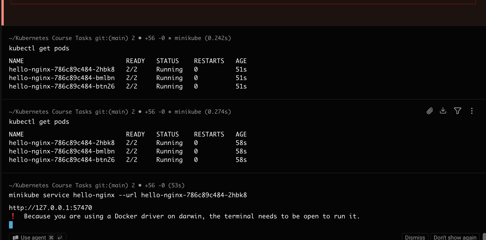
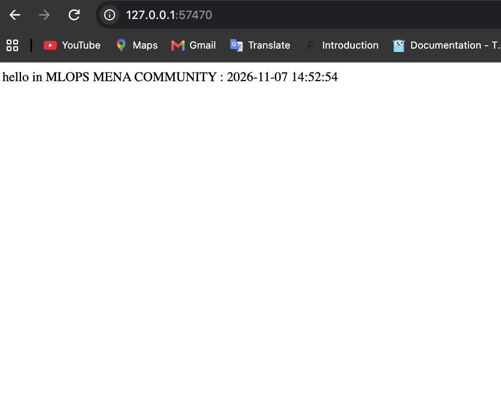
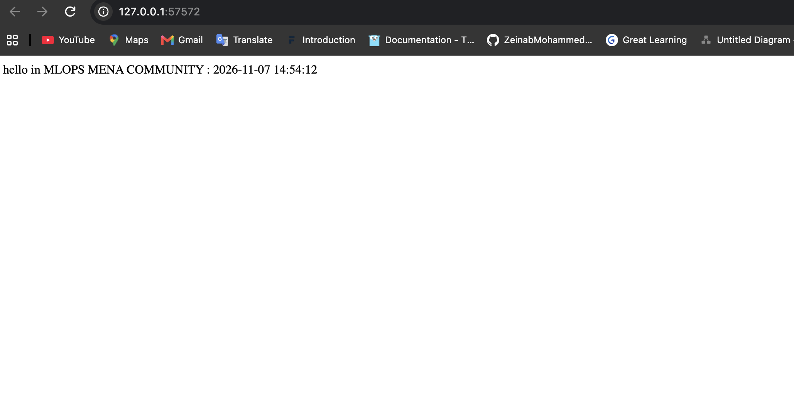
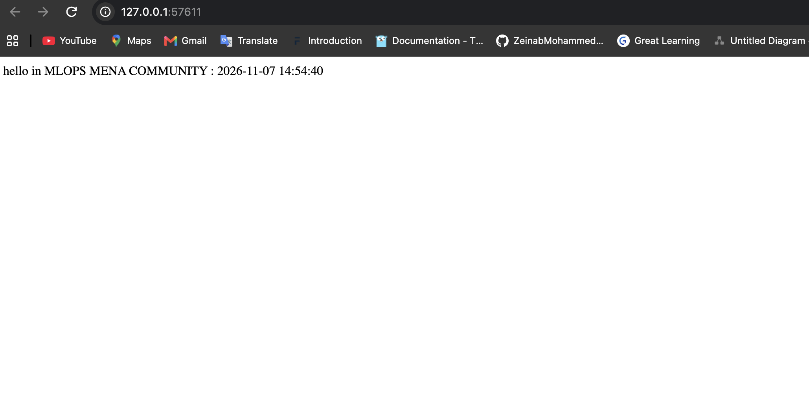
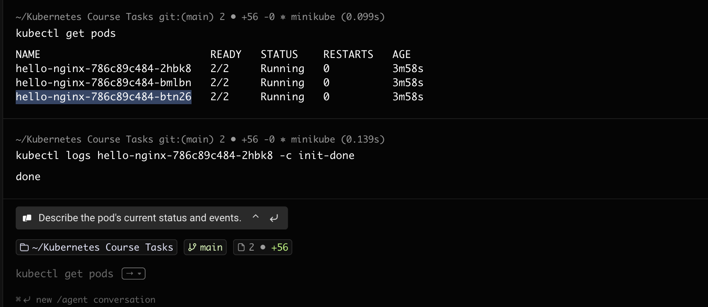
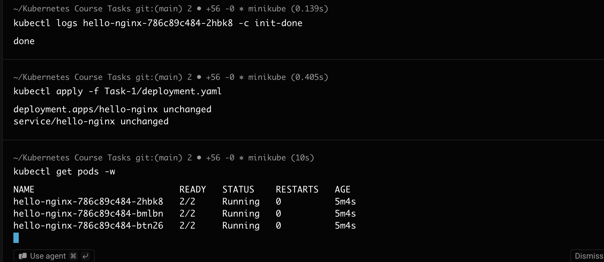
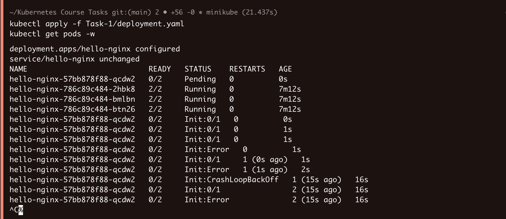
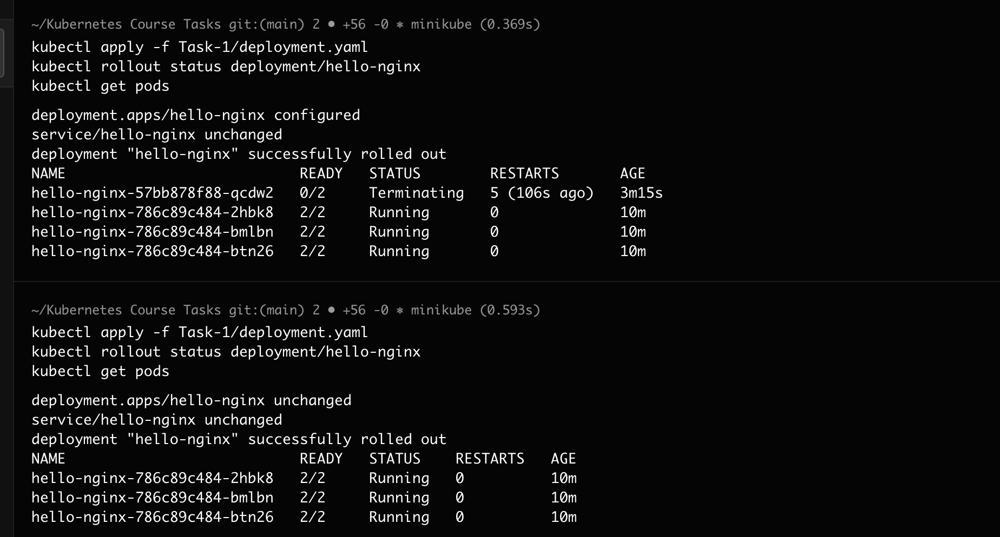

# Task 1: Multi-Container Pods (Init Container & Sidecar)

An Nginx "Hello" page on a 3-node Minikube cluster that shows the current timestamp, refreshed every 5 seconds:

```
hello in MLOPS MENA COMMUNITY : 2026-11-07 14:54:40
```

## Pod architecture

Each Pod (3 replicas through a Deployment) runs three containers. They share no volumes; they use `shareProcessNamespace: true` instead.

| Container | Type | What it does |
|---|---|---|
| `init-done` | Init container | Prints `done` and exits 0. The other containers start only after it succeeds. |
| `nginx` | Main container | Writes the first `index.html` with the current timestamp, then serves it on port 80. |
| `time-updater` | Sidecar | Every 5 s it finds the nginx PID (`pgrep -o nginx`) and rewrites `/proc/<pid>/root/usr/share/nginx/html/index.html`. |

How the sidecar reaches nginx's files without a volume:
- `shareProcessNamespace: true` puts all containers in the Pod in one PID namespace, so the sidecar can see the nginx process.
- `/proc/<pid>/root` is that process's view of its own filesystem, which is nginx's container filesystem.
- The sidecar gets the `SYS_PTRACE` capability so it is allowed to access another container's `/proc/<pid>/root`.

## Files

- `deployment.yaml`: the Deployment (3 replicas) and a NodePort Service.

## How to run

```bash
minikube start --nodes 3
kubectl apply -f Task-1/deployment.yaml
kubectl get pods -o wide
minikube service hello-nginx --url
```

## 1. Running Pods

All 3 Pods are `2/2 Running`: nginx and the sidecar are both up, and the init container finished.



## 2. Timestamp updates

The same page opened at different times shows a new timestamp, so the sidecar is updating `index.html`.





The init container's log shows it ran and printed `done`:



## 3. Forcing the init container to fail

The init command was changed to exit with an error:

```yaml
command: ["sh", "-c", "echo failing; exit 1"]
```



### Failure diagnosis

After `kubectl apply`, the Deployment started a rolling update and created a new Pod (`hello-nginx-57bb878f88-qcdw2`):

- The new Pod stays at `0/2` and goes `Init:0/1` → `Init:Error` → `Init:CrashLoopBackOff`.
- The init container exits with code 1, so Kubernetes never starts `nginx` or `time-updater` in that Pod.
- Kubernetes keeps restarting the init container and waits longer before each retry (exponential back-off). This is the `CrashLoopBackOff` state.



### Zero downtime

The 3 old Pods (`786c89c484-*`) stay `2/2 Running` during the whole failure. A rolling update removes an old Pod only after a new Pod becomes Ready, and the failing Pod never becomes Ready, so the old Pods keep serving traffic.

## 4. Recovery and verification

The init command was set back to `echo done` and applied again:

- `deployment "hello-nginx" successfully rolled out`
- The failing Pod moved to `Terminating` and was removed.
- The 3 healthy Pods are still `2/2 Running` with 0 restarts.



## Useful commands for diagnosis

```bash
kubectl get pods -w
kubectl describe pod <pod-name>
kubectl logs <pod-name> -c init-done
kubectl rollout status deployment/hello-nginx
```
